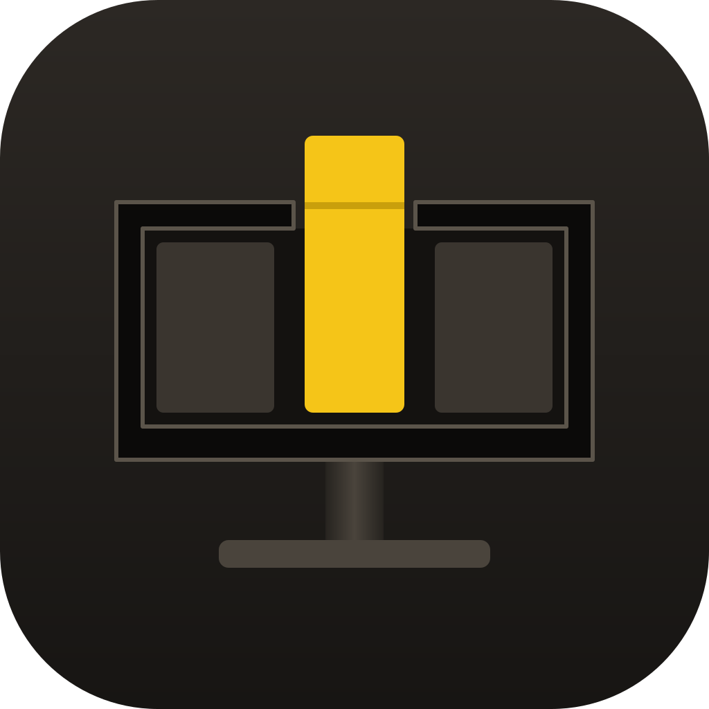

<p align="center"></p>
<h1 align="center">Slotter</h1>
<p align="center">Design your desk once, then open every app into its own slot on every monitor with one click.</p>

Slotter keeps named **workspaces**. A workspace is a set of **zones**, rectangles on your
monitors, and each zone can name the app that opens into it. Launch a workspace from the tray
(Windows) or the menu bar (macOS) and Slotter opens each app and places it in its zone, then tells
you how many landed. A zone with no app is still a slot: drag any window by its title bar and the
workspace's zones appear, and dropping the window in one snaps it there.

Window snappers such as FancyZones and Magnet arrange windows you have already opened. Slotter
also does the opening, so a workspace is a desk you can get back in one action.

## Use it

- **Left click** the tray or menu bar icon to open the designer. **Right click** for the menu:
  launch a workspace, start at login, window controls, quit.
- Keyboard shortcuts snap the front window to halves, thirds, corners and the next display
  (`Ctrl + Alt` on Windows, `⌃ ⌥` on macOS), and on Windows `Ctrl + Alt + Space` launches the last
  workspace. The designer's **Shortcuts** tab lists every one: click a shortcut to record a new
  one, clear it, or reset it, and it says when another app already holds one.
- Dragging a window by its title bar shows the active workspace's zones; release inside one to
  snap the window there.
- **Close every open app** asks visible apps to close. **Force close every open app** ends them
  after a warning, because unsaved work is lost.

## Design a workspace

The designer draws your monitors as they stand on the desk, at their real size, with the selected
workspace's zones on them. Pick a workspace from the tabs across the top, click a zone, and the
drawer underneath edits it: the app it opens, its position and size as percentages of the screen,
split it, delete it, or apply one of nine layouts to the whole monitor. **Manage programs…**
defines each app once (name, program or `.app`, optional arguments); renaming one updates every
zone that uses it. Every edit saves as you make it and undo steps back through them; anything that
would not work, such as a zone running off the edge of its screen, says where and is not saved
until it is fixed.

A connected monitor the workspace does not use yet is drawn greyed out with a **+**: press it to
set that monitor up. A workspace for a monitor that is not connected stays listed and editable,
marked offline.

**+ Virtual** pins a copy of a monitor to one virtual desktop (a Space on macOS). It sits under
the desk as its own plate, you name it and draw its zones like any other, and on that desktop its
zones replace the monitor's own for drag-snap. Switching desktop never opens apps or moves
windows. Bench a plate when you are done with that desktop and pull it out again onto any desktop
later.

## Permissions

- **Windows**: Slotter asks to run as administrator (one UAC prompt) because Windows only lets an
  elevated app move an elevated window, such as Task Manager or an admin terminal.
- **macOS**: Slotter needs Accessibility permission to move other apps' windows and asks for
  nothing else. It never reads window contents or keystrokes. Telling which Space is showing
  uses private macOS calls, as yabai and Hammerspoon do; if a macOS update breaks them, the
  feature reports itself unavailable and nothing else changes. See [`mac/README.md`](mac/README.md).

## Configuration

Everything lives in a plain `profiles.ini`: `%LOCALAPPDATA%\Slotter\profiles.ini` on Windows,
`~/Library/Application Support/Slotter/profiles.ini` on macOS. It is safe to edit by hand, and
the macOS build picks edits up live. Monitors are named from their own EDID; to call one
something else on Windows, add a line under `[Displays]` keyed by the display's EDID identity,
such as `GSMC0C8-UID4352=Left screen`. The designer draws monitors at their real size
when they report it; TVs often do not, so give a diagonal in inches under `[DisplaySizes]`, keyed by
the name the designer shows, such as `LG TV SSCR2=48`. Coming from Snappy, Slotter's name before 1.0: the first run
carries your workspaces over.

## Install

Download the macOS DMG or Windows ZIP from [GitHub Releases](https://github.com/kalkman-code/slotter/releases).

- **Windows**: unzip the release, then run `Slotter.exe`. The executable is signed by Toby Kalkman using Certum open source code signing. SmartScreen may still warn on a new download until the certificate builds reputation. Slotter asks for administrator permission once because Windows only lets an elevated app move an elevated window.
- **macOS**: open the DMG, drag Slotter to Applications, then open it. Allow Accessibility when macOS asks so Slotter can move other apps' windows.

Requirements: Windows 10 version 1809 or later (64-bit); macOS 14 or later.

## Build from source

**Windows** (Windows 10 or 11, .NET 10 SDK):

```powershell
.\install.ps1
```

This publishes a self-contained `Slotter.exe`, installs it to `%LOCALAPPDATA%\Slotter`, adds a
Start Menu entry and nothing else: no desktop shortcut, and no autostart unless you turn on
**Start with Windows** in Slotter itself.

**macOS** (macOS 14 or later, Xcode command line tools):

```sh
cd mac && ./build.sh --install
```

This builds, signs with your Apple Development identity (set `SLOTTER_SIGN_IDENTITY`), and
installs to `/Applications/Slotter.app`. Run it from Terminal rather than over SSH: signing needs
the login keychain unlocked. macOS ties the Accessibility grant to the signature, so an ad-hoc
signature would drop it on every rebuild.

The two builds share no code: Windows is .NET 10 and WPF in `src/`, macOS is Swift, AppKit and
SwiftUI in `mac/`. Both wear the same design, set in Bricolage Grotesque (SIL Open Font Licence,
in `fonts/`).

## Licence

GPL-3.0-only; see [LICENSE](LICENSE).
